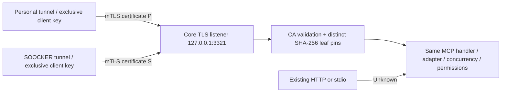

# Trusted ingress deployment and rollback

## Observed topology and evidence (2026-10-22)

Read-only Docker inspection confirmed a healthy Core and two running `ghcr.io/openai/tunnel-client:v0.0.15` containers, both sharing the Core container's network namespace. Local Compose points both at `http://127.0.0.1:3210/mcp`. No live credential files, payload logs, or account identifiers were needed or copied into this repository.

An isolated `--network none` invocation of that installed image's `/usr/bin/tunnel-client run --help` reported version `0.0.15+a390c168ff1b2d14e73a95991c186c6aba3ff5a0` and confirmed these flags:

- `--mcp.client-cert`, `--mcp.client-key`: client TLS credentials for MCP.
- `--ca-bundle`: additional outbound TLS CA trust.
- `--mcp.server-url`: MCP target, including TLS targets and per-target client certificates.
- `--mcp.extra-headers`: static outbound headers (supported, but **not used as the trust mechanism**).

Same source IP/network namespace and unverified headers cannot distinguish the present routes. They remain Unknown until an operator applies the new wiring. Production services were not restarted or reconfigured. Automated tests validate real TLS handshakes and MCP requests with ephemeral test credentials; they do not claim real account/control-plane tunnel traffic has been migrated or accepted.

## Implemented boundary



Core optionally starts a second, loopback-only HTTPS listener in the same process. It shares the MCP handler, adapter, concurrency, native request cancellation and shutdown management with existing HTTP. Existing Host, Origin, bearer authentication, hot-swap fencing and endpoint checks still run. TLS requires a trusted client certificate; a CA-signed but unpinned certificate receives 403. A Personal certificate cannot claim SOOCKER through any header. Regular HTTP always gets null/false even with forged labels.

TLS is end-to-end from each tunnel-client to Core. No local proxy injects identity. Do not terminate TLS at a generic proxy and forward identity headers. The existing HTTP hot-swap router does not authenticate/preserve these certificate identities; traffic through it remains Unknown. If future hot-swap wiring moves the TLS listener, separately review end-to-end credential forwarding; this change does not alter existing router semantics.

Trust means **possession of the mapped tunnel-route private key**, not a person or ChatGPT workspace. Wrong operator certificate assignment produces wrong route labels; the reviewed wiring and real route acceptance below are necessary. Host root, Docker administrators and arbitrary Core code execution are outside this boundary. Never mount the CA signing key or either tunnel's client private key into Core, shell sandboxes, shared filesystem roots, sibling tunnel, or a shared secrets directory. Keep only that tunnel's own key in each tunnel container. Preserve existing tunnel restrictions and authentication. An unrestricted shell that can reach a credential or mutate Core already compromises this boundary; review mounts/UIDs before enabling verified attribution. Network namespace sharing alone does not grant access to another container's files.

## Configuration

Set `CHATGPT_MCP_INGRESS_CONFIG=/run/mcp-ingress/config.json` in Core. Omit it to retain HTTP-only behavior. Invalid config fails startup with a generic error; it never silently enables insecure TLS. The file is operator-owned JSON, not an MCP config/tool input:

```json
{
  "host": "127.0.0.1",
  "port": 3321,
  "certFile": "/run/mcp-ingress/server.crt",
  "keyFile": "/run/mcp-ingress/server.key",
  "caFile": "/run/mcp-ingress/client-ca.crt",
  "personalFingerprint": "<64 lowercase SHA-256 hex characters; no colons>",
  "soockerFingerprint": "<different 64 lowercase SHA-256 hex characters>"
}
```

Host permits only `127.0.0.1` or `::1`. Port must be 1–65535, distinct from HTTP. Certificate pins are exact leaf certificate SHA-256 fingerprints; renewal requires updating pins. Use a dedicated client CA, clientAuth EKU for clients, serverAuth EKU and a matching IP SAN for the server. Example fingerprint command (public certificate only):

```sh
openssl x509 -in personal-client.crt -noout -fingerprint -sha256
```

Remove separators before storing the pin. Keep the issuing CA private key offline. Provision credentials with your existing PKI process; do not commit them. Server and clients need readable, narrowly mounted credentials. Test keys are generated only in temporary directories and removed.

## Build and isolated checks (safe before production approval)

1. Check out the reviewed commit, `pnpm install --frozen-lockfile`, `pnpm gate`. Build an immutable Core image. `deploy/Dockerfile.trace-v2` overlays code/dependencies onto an explicitly selected existing runtime base, preserving installed OS tooling; review `/app` as the application directory for your base. Do not use the existing production tag for the new build.
2. Example for the observed runtime layout:

   ```sh
   docker build -f deploy/Dockerfile.trace-v2 --build-arg CORE_BASE_IMAGE=chatgpt-mcp-local:0.2.0-document-read.1 -t chatgpt-mcp-local:core-access-trace-v2-review .
   ```

3. Start a separately named test container with synthetic mounts/config/keys only, no production secrets, no control-plane connection, no host-port conflict. Verify HTTP health and MCP; test filesystem paths in two synthetic mount namespaces, denied/missing paths, shell cwd, mTLS Personal/SOOCKER and spoofed headers. Remove only the test container afterwards.
4. Confirm the actual image contains `/app/dist/src/audit.js` and `trusted-ingress.js`. Keep HTTP health probes on the existing port. Do not alter grants, roots, Trash rules, shell allowlist, config mounts or production history volumes to enable tracing.

## Operator-reviewed deployment window (not executed by this PR)

1. Record current image **ID** and Compose/config revision. Back up operator Compose/config and Console history using existing host-only procedures; do not place backups in this public repo. Ensure no active state-changing calls/durable jobs would be interrupted. Retain the previous image and runtime config.
2. Review all credential mounts: split any broad shared secrets directory so each tunnel exclusively gets its own client key. Core gets server key + CA certificate + pin config only. Neither client key nor CA signing key is reachable by MCP tools. No additional privileges, ports exposed to host/public networks, Docker socket mounts, or capability grants are needed.
3. In the existing private Compose, change only Core's immutable image, add the ingress config/server credential mounts, and set `CHATGPT_MCP_TRACE=1`; enable `CHATGPT_MCP_TRACE_PATHS=1` only with the owner's path-privacy opt-in. Keep working directory, File Safety mounts, environment and HTTP healthcheck unchanged.
4. Preserve each tunnel's full existing command, tunnel ID, control-plane auth, cloudflared settings, network mode, health port and restrictions. Replace its MCP target with `https://127.0.0.1:3321/mcp`; append these flags using that tunnel's own mounted files:

   ```text
   --mcp.client-cert=/run/route-identity/client.crt
   --mcp.client-key=/run/route-identity/client.key
   --ca-bundle=/run/route-identity/server-ca.crt
   ```

   Each tunnel can use the same in-container path because its bind source is different. Retain existing MCP bearer auth if configured. Never disable server TLS verification. Do not merely add label headers. `deploy/ingress-wiring.example.yaml` is a wiring reference, not an executable replacement for the operator Compose.
5. Validate the merged Compose privately, then recreate the Core and both namespace-sharing tunnels together in the approved maintenance window. Shared network namespace dependencies mean recreating Core alone may strand its old dependent tunnels. This PR does not run any production recreation commands.
6. Check HTTP health, TLS health with each client certificate, existing bearer/Host/Origin denials, both tunnel health/control-plane connection states, original tool discovery/grants, and one real harmless `fs.list` from each connector. Record requestId and verified source. A missing certificate or unpinned certificate must fail on TLS; a forged source on legacy HTTP must remain Unknown.
7. Verify the separately implemented Console parser with both v1/v2 fixtures and live lines: correct path/project, cross-project move, cwd label, Unknown fallback, lifecycle merge and history retention. Do not declare production acceptance until both real connector routes and Console checks pass.

## Rollback

1. Use the same coordinated maintenance procedure. Restore the saved Core image ID/config/Compose revision and both original `http://127.0.0.1:3210/mcp` targets. Remove the new TLS flags/mounts and `CHATGPT_MCP_INGRESS_CONFIG`; restore prior trace/path opt-in values. Keep existing grants, runtime data, jobs and Console history volumes.
2. Recreate Core and both dependent tunnels together only within the approved window. Check HTTP health, both tunnel health states, tool discovery and harmless reads from each original connector.
3. Logs created during v2 remain valid historical records. Legacy/new HTTP traffic truthfully returns Unknown after rollback. Do not delete Access History to roll back code. Revoke newly issued credentials if rollout is abandoned or a key may have been exposed.

For certificate rotation, issue two distinct new leaves, review their assignments/pins and perform the same coordinated update. Exact pins intentionally reject unreviewed replacements. An expired or missing certificate fails TLS; there is no automatic fallback that would mislabel a route as verified.

## Reproduce the isolated Linux gate and runtime smoke

The gate includes Linux `/proc` and `SO_PEERCRED` tests. A Docker init process is required to reap descendant processes in the existing cancellation tests. These commands use separate image/container names, no production volumes, no external network at execution time, and remove only their temporary containers:

```sh
docker build --target verify -f deploy/Dockerfile.trace-v2 \
  --build-arg CORE_BASE_IMAGE=chatgpt-mcp-local:0.2.0-document-read.1 \
  -t chatgpt-mcp-local:core-access-trace-v2-gate .
docker run --rm --init --network none \
  --name core-access-trace-v2-gate chatgpt-mcp-local:core-access-trace-v2-gate

docker run --rm --init --network none --name core-access-trace-v2-smoke \
  --mount "type=bind,src=$PWD/scripts/verify-access-trace.mjs,dst=/app/scripts/verify-access-trace.mjs,readonly" \
  -e CHATGPT_MCP_SYNTHETIC_SMOKE=1 --entrypoint node \
  chatgpt-mcp-local:core-access-trace-v2-review /app/scripts/verify-access-trace.mjs
```

The runtime smoke refuses execution unless the explicit synthetic-test marker is present. It creates two fresh synthetic mount directories, performs seven real HTTP tool calls, verifies content is returned unchanged but absent from trace, checks cross-project and cwd semantics, and deletes only its synthetic directories. Never run it against a host installation or with production mounts.
